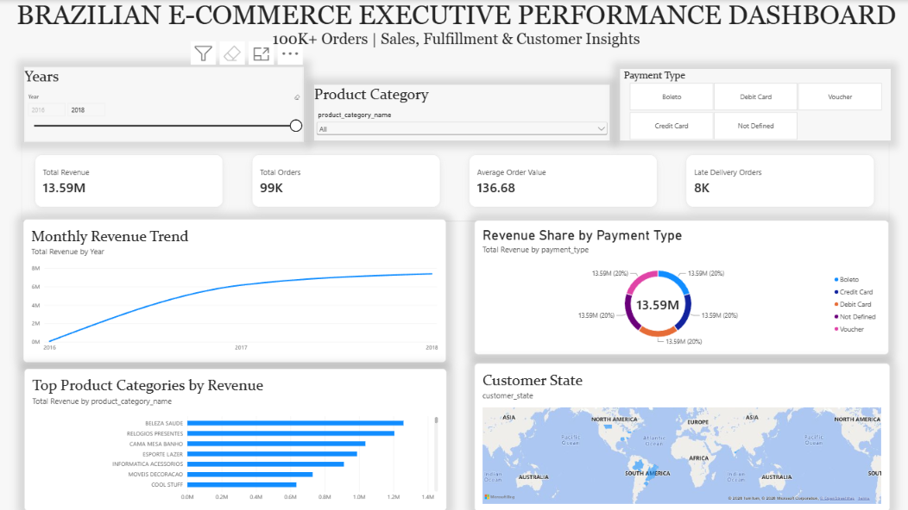

# Brazilian-Ecommerce-PowerBI-SQL-Analysis

End-to-end E-Commerce Performance Dashboard & SQL Cross-Verification on 100K+ Olist orders using Power BI, DAX, Power Query, and SQL.

## Overview
This project analyzes over **100,000+ e-commerce orders** (2016–2018) from the Brazilian marketplace **Olist**. Multi-table transactional records were cleaned, modeled into a Star Schema, and visualized in Power BI to track revenue growth, fulfillment performance, payment preferences, and regional demand, alongside SQL queries used to cross-verify key metrics.

## Key Metrics
* **Total Revenue:** R$ 13.59M[cite: 1, 2]
* **Total Orders:** 99K+ orders across 112K+ order items[cite: 1, 2]
* **Average Order Value (AOV):** R$ 136.68[cite: 1, 2]
* **Late Delivery Orders:** ~8K orders (8.1% of total orders), highlighting delivery window delays to investigate[cite: 2]
* **Top Product Categories & States:** Tracked revenue leaders across categories and customer concentration across Brazilian states (such as SP, RJ, and MG)[cite: 1, 2]
* **Payment Mix:** Compared revenue and order distribution across payment methods (Credit Card, Boleto, Voucher, Debit Card)[cite: 1, 2]

## Tech Stack
* **Power BI Desktop:** Interactive dashboard design, slicers, KPI cards, and visual storytelling[cite: 1, 2]
* **Power Query:** Data cleaning, type standardization, null/blank handling, and text formatting
* **DAX:** Custom measures for revenue, order counts, averages, and delivery performance
* **Data Modeling:** Star Schema linking order/item facts with customer, product, payment, and calendar dimensions
* **SQL:** Relational queries used to cross-check and validate dashboard aggregations
